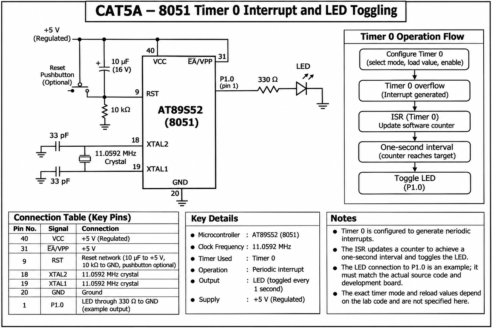

# EXPERIMENT DETAILS

**EXP:** CONTINUOUS ASSESSMENT 5 (CAT5)

**DATE:** 10/08/2026

**NAME OF EXP:** Hardware Timer and Interrupt Programming

**HARDWARE SETUP / PLATFORM:**
- Microcontroller: AT89S52 (8051 Architecture)
- Crystal Frequency: 11.0592 MHz
- Software: Keil µVision IDE
- Output Peripheral: On-board / External LED

**TASK NO:** CAT5A – Timer 0 Overflow Interrupt

## CIRCUIT DIAGRAM

## OBJECTIVE

- Initialize and configure Timer 0 on the 8051 microcontroller via the `TMOD` register.
- Generate deterministic, periodic hardware interrupts upon Timer 0 register overflow.
- Toggle an output LED precisely at 1-second intervals without blocking the main CPU loop.
- Demonstrate Interrupt Service Routine (ISR) execution and hardware timer register configuration.

## CORE LOGIC

1. Set the Timer 0 operating mode (such as 16-bit Mode 1) by configuring the `TMOD` register.
2. Preload the high and low timer registers (`TH0` and `TL0`) with calculated initial counts for a fixed tick interval.
3. Unmask the Timer 0 overflow interrupt by setting the `ET0` bit in the `IE` register.
4. Activate global interrupt handling by setting the `EA` (Enable All) bit.
5. Start the hardware timer counting by asserting the `TR0` run control bit in `TCON`.
6. Trigger the Timer 0 Interrupt Service Routine (`interrupt 1`) automatically on each overflow event, reloading `TH0` and `TL0`.
7. Increment a software tick counter inside the ISR until the accumulated ticks equal a 1-second duration.
8. Invert the logic state of the target LED pin once the 1-second threshold is reached and reset the counter.
9. Allow the main routine to idle or execute background tasks continuously while interrupts drive the timing.

## INFERENCE

Timer 0 on the AT89S52 microcontroller was successfully programmed to generate periodic hardware overflow interrupts driven by an 11.0592 MHz crystal oscillator. Using an Interrupt Service Routine paired with a tick accumulator enabled accurate, non-blocking 1-second LED toggling, validating hardware timer configuration and interrupt-driven execution in bare-metal Embedded C.