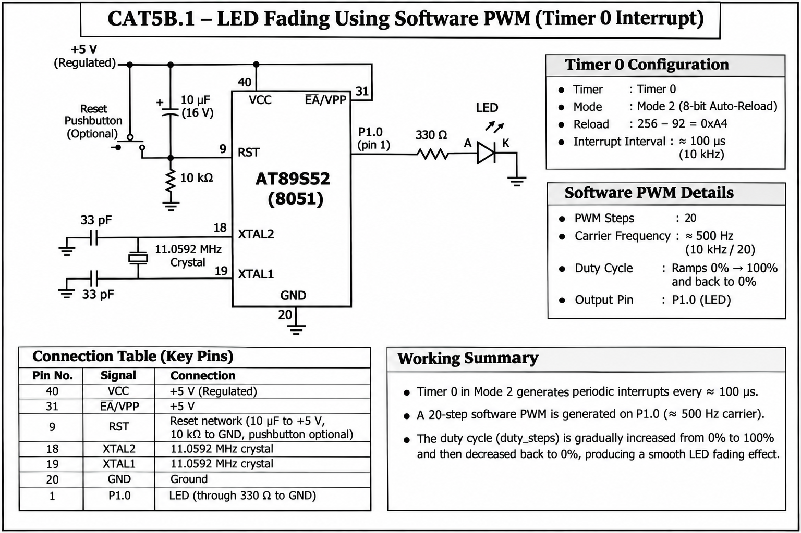

# EXPERIMENT DETAILS

**EXP:** CONTINUOUS ASSESSMENT 5 (CAT5)

**DATE:** 10/08/2026

**NAME OF EXP:** Hardware Timer and Interrupt-Based Timing for LED Fading, Pulse Generation, and Stepper Motor Control

**HARDWARE SETUP / PLATFORM:** AT89S52 (11.0592 MHz) + Keil C51 µVision

---

## TASK 5B.1: LED Fading Using Software PWM (Timer 0 Interrupt)

### 1. Hardware Setup & Circuit Diagram

- **MCU:** AT89S52 clocked at 11.0592 MHz
- **PWM Pin:** `P1.0` connected to an LED via a current-limiting 330 Ω resistor.
- **Timer:** Timer 0 configured in Mode 2 (8-bit auto-reload).
- **Timer Interrupt Interval:** ~100 µs per overflow tick.
- **PWM Carrier Frequency:** ~500 Hz (2 ms period).

### 2. Core Logic / Pseudocode / Code Base

**Working Principle:**

Timer 0 operates in 8-bit auto-reload mode to trigger hardware interrupts roughly every 100 µs. Inside the Interrupt Service Routine (ISR), a 20-step modulo counter synthesizes a 500 Hz Pulse Width Modulation (PWM) waveform on pin `P1.0`. By ramping the active duty cycle smoothly from 0% up to 100% and back down to 0%, the average power delivered to the LED varies continuously, creating a breathing/fading brightness effect.

**Pseudocode:**

1. Initialize Timer 0 in Mode 2 (8-bit auto-reload) via the `TMOD` register.
2. Preload `TH0` and `TL0` with the calculated reload constant for a ~100 µs interrupt period.
3. Unmask Timer 0 overflow interrupts (`ET0 = 1`) and activate global interrupts (`EA = 1`), then start the timer (`TR0 = 1`).
4. Inside the Timer 0 ISR, advance `pwm_tick` modulo 20 on every interrupt.
5. Compare the counter against the threshold: drive `P1.0` HIGH while `pwm_tick < duty_steps`, and pull `P1.0` LOW otherwise.
6. Track elapsed interrupts and adjust the brightness level once every 500 ticks (~50 ms).
7. Ramp `duty_steps` linearly upward from `0` to `20`, then reverse direction back down to `0`.
8. Run indefinitely inside the main background loop.

**Code Base:**

- Timer 0 Mode 2 eliminates manual register reload overhead inside the ISR, ensuring jitter-free 100 µs intervals.
- Software-synthesized PWM modulates perceived LED luminance smoothly via duty-cycle scaling.
- All waveform generation and duty-step transitions execute asynchronously inside the ISR.

**Build Note:** Recompile `TASK5B_1.uvproj` inside Keil µVision (C51) to produce a fresh `Objects/TASK5B_1.hex` binary before programming the AT89S52 target board.

### 3. Inference

Interrupt-driven software PWM was successfully realized on the AT89S52 using Timer 0 in 8-bit auto-reload mode. Modulating the duty cycle smoothly between 0% and 100% at a 500 Hz carrier frequency achieved flicker-free, gradual LED dimming and brightening.