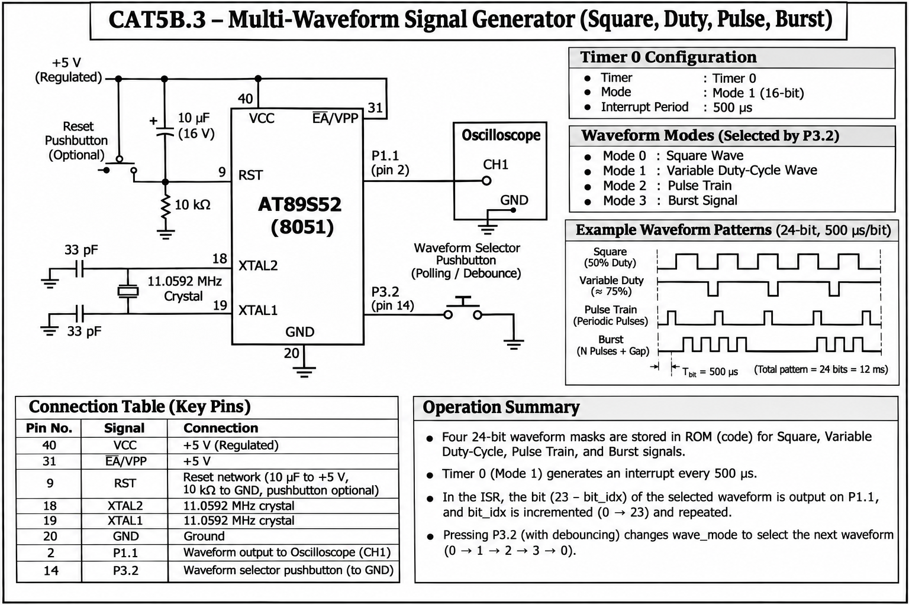

# EXPERIMENT DETAILS

**EXP:** CONTINUOUS ASSESSMENT 5 (CAT5)

**DATE:** 10/08/2026

**NAME OF EXP:** Hardware Timer and Interrupt-Based Timing for LED Fading, Pulse Generation, and Stepper Motor Control

**HARDWARE SETUP / PLATFORM:** AT89S52 (11.0592 MHz) + Keil C51 uVision + Oscilloscope

---

## TASK 5B.3: Multi-Waveform Signal Generator (Square, Duty, Pulse, Burst)

### 1. Hardware Setup & Circuit Diagram

- **MCU:** AT89S52 clocked at 11.0592 MHz
- **Signal Output:** `P1.1` routed to Oscilloscope Channel 1
- **Waveform Selector:** Tactile pushbutton connected to `P3.2`
- **Waveform Modes:**
  - Square Wave
  - Variable Duty-Cycle Wave
  - Pulse Train
  - Burst Signal

### 2. Core Logic / Pseudocode / Code Base

**Working Principle:**

The arbitrary waveform generator relies on pre-encoded 24-bit binary templates stored in code memory (ROM). Timer 0 is programmed to fire hardware interrupts at fixed 500 µs intervals; during each ISR execution, a single bit of the active 24-bit pattern is serialized out onto pin `P1.1`, progressing sequentially from the Most Significant Bit (MSB) to the Least Significant Bit (LSB).

Pressing the selector switch attached to `P3.2` cycles cleanly across the four distinct waveform templates.

**Pseudocode:**

1. Define the four 24-bit waveform bitmasks inside a constant ROM lookup array.
2. Initialize Timer 0 to trigger periodic overflow interrupts every 500 µs and enable global interrupts.
3. Inside the Timer 0 ISR:
   - Extract bit `(23 - bit_idx)` from the active 24-bit mask and drive `P1.1` accordingly.
   - Advance `bit_idx` modulo 24 to step to the subsequent time slot.
4. Poll the `P3.2` pushbutton input and apply software debouncing to validate keystrokes.
5. Increment `wave_mode` modulo 4 upon each confirmed press to switch waveforms.

**Code Base:**

- `waveforms[4]` holds the four 24-bit binary signal patterns in read-only memory.
- `bit_idx` maintains the current serial bit offset within the 24-slot frame.
- `wave_mode` indexes the currently selected signal profile.
- A unified, data-driven ISR synthesizes all four waveform shapes without mode-specific branching overhead.

**Build Note:** Recompile `TASK5B_3.uvproj` in Keil C51 uVision to produce a fresh `Objects/TASK5B_3.hex` binary prior to flashing the AT89S52 target board.

### 3. Inference

Time-slotted bit serialization driven by Timer 0 interrupts proved an effective method for synthesizing multiple digital signal profiles on a single GPIO output pin. By shifting 24-bit ROM templates at 500 µs intervals, the AT89S52 reliably generated square, variable-duty, pulse-train, and burst waveforms observable on the oscilloscope.
