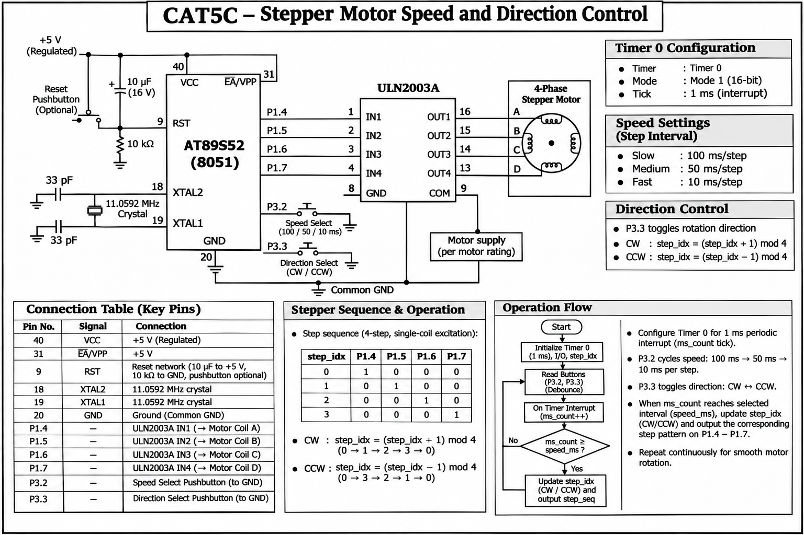

# EXPERIMENT DETAILS

**EXP:** CONTINUOUS ASSESSMENT 5 (CAT5)

**DATE:** 10/08/2026

**NAME OF EXP:** Hardware Timer and Interrupt-Based Timing for LED Fading, Pulse Generation, and Stepper Motor Control

**HARDWARE SETUP / PLATFORM:** AT89S52 (11.0592 MHz) + 8051 Development Board

---

## TASK 5C: Stepper Motor Speed and Direction Control

### 1. Hardware Setup & Circuit Diagram

- **MCU:** AT89S52 clocked at 11.0592 MHz
- **Output Device:** Unipolar/Bipolar Stepper Motor (via Driver IC)
- **Control Method:** Hardware Timer Interrupt-Driven Step Sequencing
- **Task Status:** Optional extension for this lab session



### 2. Core Logic / Pseudocode / Code Base

**Working Principle:**

Timer 0 overflow interrupts dictate the exact commutation period between consecutive excitation phases of the stepper motor. On each timer interrupt event, the Interrupt Service Routine (ISR) advances the phase index and outputs the corresponding 4-bit coil excitation pattern to rotate the rotor shaft smoothly.

Rotational speed (RPM) is adjusted dynamically by modifying the timer interrupt interval separating successive step transitions, while reversing the array traversal direction reverses shaft rotation.

**Step Sequence:**

```text
1000
0100
0010
0001