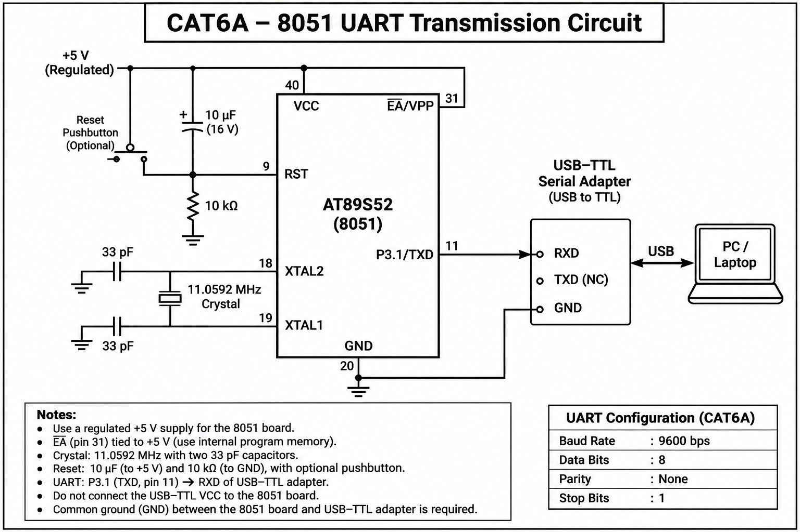

# CAT6A – 8051 Serial UART Setup and Character Transmission

## Experiment Details
- **Course:** 25CS2741 – Fundamentals of Internet of Things + Lab
- **Experiment:** Serial UART Setup and Character Transmission
- **Date:** 17/08/26
- **Microcontroller:** AT89S52 (8051 Architecture)
- **Software:** Keil µVision IDE
- **Programming Language:** Embedded C

## Aim
To initialize the on-chip Universal Asynchronous Receiver-Transmitter (UART) peripheral on the AT89S52 microcontroller and stream text data serially to a host PC serial terminal.

## Hardware Requirements
- AT89S52 Target Development Board
- USB-to-TTL Serial Adapter
- USB Interface Cable
- Host PC running PuTTY Serial Terminal

## UART Configuration
- **Communication Mode:** Mode 1 (8-bit variable baud rate UART)
- **Baud Rate:** 9600 bps (generated via Timer 1 Mode 2)
- **Stop Bits:** 1 Stop Bit
- **Parity:** None
- **Communication:** Full-Duplex Asynchronous Serial Protocol

## Pin Configuration

| AT89S52 Pin | Connection |
|---|---|
| P3.1 (TXD) | USB-to-TTL RX |
| P3.0 (RXD) | USB-to-TTL TX |
| GND | USB-to-TTL GND |

## Circuit Diagram

## Task Description
- Configure the serial control register (`SCON`) for 8-bit UART communication.
- Program Timer 1 in 8-bit auto-reload mode to establish a 9600 bps baud rate.
- Continuously transmit the string payload over the serial TXD line:

  Hello from 8051

- Monitor and verify the incoming serial text stream on the host PC via PuTTY.

## Algorithm
1. Set `SCON` to `0x50` to select 8-bit UART Mode 1 and enable serial reception.
2. Configure Timer 1 in Mode 2 (8-bit auto-reload) via `TMOD` and preload `TH1` with `0xFD` for 9600 bps at 11.0592 MHz.
3. Start Timer 1 by setting the `TR1` control bit.
4. Write a single byte of the string into the Serial Buffer (`SBUF`) register.
5. Poll the Transmit Interrupt flag (`TI`) until hardware shifting completes, then manually clear `TI`.
6. Advance through every character in the string and loop indefinitely.

## Source Files
- `uart_tx.c` – Bare-metal Embedded C UART transmission source code.
- `uart_tx.uvproj` – Keil µVision project file.
- `Objects/uart_tx.hex` – Compiled Intel HEX firmware image.
- `circuit.png` – Hardware wiring and serial interface diagram.

## Result
Successfully initialized the AT89S52 UART peripheral at 9600 bps using Timer 1 auto-reload timing, and verified continuous, error-free serial transmission of the text string onto the PC PuTTY terminal.
