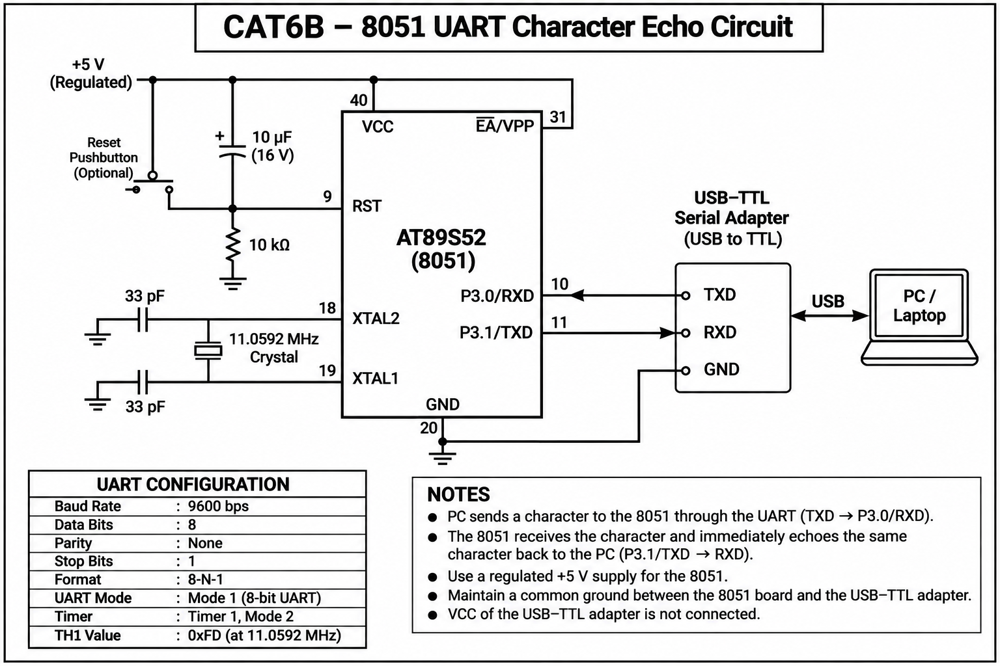

# EXPERIMENT DETAILS

**EXP:** CONTINUOUS ASSESSMENT 6 (CAT6)

**DATE:** 17/08/2026

**NAME OF EXP:** UART Serial Driver and Bidirectional Terminal Debugging

**HARDWARE SETUP / PLATFORM:**
- Microcontroller: AT89S52 (8051 Architecture)
- Crystal Frequency: 11.0592 MHz
- Compiler: Keil µVision C51
- Serial Interface: USB-to-TTL Converter Module
- Terminal Software: PuTTY Serial Console
- Baud Rate: 9600 bps

**TASK NO:** CAT6B – Full-Duplex UART Character Echo

## CIRCUIT DIAGRAM

## CORE LOGIC

1. Configure the serial port in Mode 1 (8-bit variable-baud asynchronous UART).
2. Set Timer 1 to Mode 2 (8-bit auto-reload) via `TMOD` to serve as the baud rate generator.
3. Load `TH1 = 0xFD` to achieve a precise 9600 bps baud rate with an 11.0592 MHz crystal.
4. Enable serial reception (`REN = 1`) and select 8-bit UART mode by writing `SCON = 0x50`.
5. Assert `TR1 = 1` to start Timer 1 counting.
6. Poll the Receive Interrupt (`RI`) flag continuously until an incoming byte arrives.
7. Fetch the received byte from the Serial Buffer (`SBUF`) register.
8. Reset the `RI` flag in software so subsequent incoming bytes can be detected.
9. Load the captured byte back into `SBUF`, wait for the Transmit Interrupt (`TI`) flag, and clear `TI`.
10. Loop indefinitely to echo every keystroke typed in the host terminal back to the screen.

## UART CONFIGURATION

| Parameter | Configuration |
|---|---|
| UART Mode | Mode 1 (8-bit UART) |
| Baud Rate | 9600 bps |
| Data Bits | 8 |
| Parity | None |
| Stop Bits | 1 |
| Timer | Timer 1, Mode 2 (Auto-Reload) |

## HARDWARE CONNECTIONS

| AT89S52 Pin | USB-to-TTL Pin |
|---|---|
| P3.0 / RXD (Pin 10) | TXD |
| P3.1 / TXD (Pin 11) | RXD |
| GND | GND |

A shared ground (`GND`) reference must be established between the AT89S52 target board and the USB-to-TTL serial converter to ensure reliable logic-level signaling.

## INFERENCE

Bidirectional UART serial communication was successfully realized on the AT89S52 microcontroller. Incoming characters sent from the host PC terminal were accurately captured via `SBUF` and immediately looped back to the transmitter, validating full-duplex asynchronous serial driver operation and hardware debugging capability.
