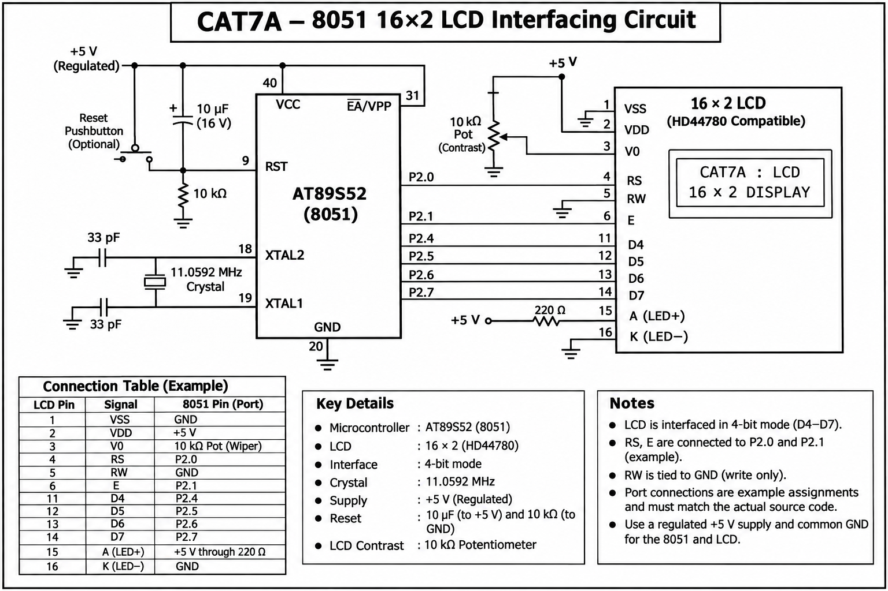

# EXPERIMENT DETAILS

**EXP:** CONTINUOUS ASSESSMENT 7 (CAT7)

**DATE:** 24/08/2026

**NAME OF EXP:** Alphanumeric 16×2 LCD Interfacing and Display Control

**HARDWARE SETUP / PLATFORM:**
- Microcontroller: AT89S52 (8051 Architecture)
- Display Module: 16×2 Character LCD (HD44780 Controller Compatible)
- Interface Mode: 4-Bit Parallel Data Bus
- Crystal Frequency: 11.0592 MHz
- Software: Keil µVision IDE

**TASK NO:** CAT7A – 4-Bit LCD Initialization and Character/String Rendering

## CIRCUIT DIAGRAM

## OBJECTIVE

- Establish a hardware interface between a 16×2 character LCD and the AT89S52 microcontroller.
- Execute the HD44780 4-bit initialization sequence to conserve GPIO port pins.
- Develop modular low-level driver routines for sending control commands and ASCII character data.
- Render single characters as well as null-terminated text strings onto the display.
- Address DDRAM memory locations to position text across both lines of the LCD screen.

## CORE LOGIC

1. Assign and configure the GPIO port pins connected to the LCD control lines (`RS`, `RW`, `EN`) and upper data nibble (`D4`–`D7`).
2. Execute the power-on reset delay followed by the standard nibble-mode initialization sequence (`0x02`, `0x28`) to select 4-bit, 2-line operation.
3. Issue display control and entry mode commands (`0x0C` / `0x0E`, `0x06`, `0x01`) to configure cursor behavior and clear DDRAM.
4. Implement `lcd_cmd()` to pull `RS` LOW and latch upper and lower command nibbles via enable (`EN`) pulses.
5. Implement `lcd_data()` to drive `RS` HIGH and latch upper and lower ASCII character nibbles into DDRAM.
6. Set the DDRAM cursor address (`0x80` for Row 1, `0xC0` for Row 2) and transmit the target characters and strings sequentially.
7. Verify clean, legible text output across both rows of the 16×2 LCD panel.

## INFERENCE

A 16×2 HD44780-compatible LCD was successfully interfaced with the AT89S52 microcontroller operating in 4-bit nibble mode. Modular command and data driver functions enabled reliable display initialization, cursor positioning, and multi-line character and string rendering while minimizing GPIO pin usage.
