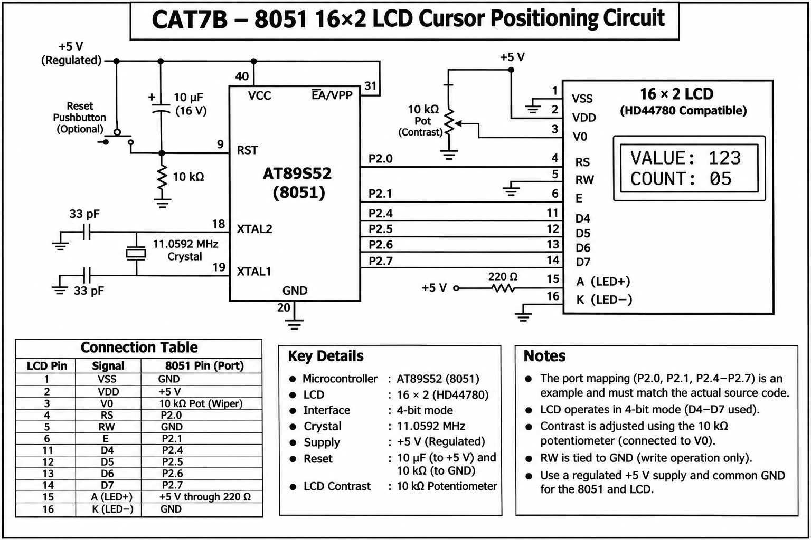

# EXPERIMENT DETAILS

**EXP:** CONTINUOUS ASSESSMENT 7 (CAT7)

**DATE:** 24/08/2026

**NAME OF EXP:** Alphanumeric 16×2 LCD Interfacing and Display Control

**HARDWARE SETUP / PLATFORM:**
- Microcontroller: AT89S52 (8051 Architecture)
- Display Module: 16×2 Character LCD (HD44780 Controller Compatible)
- Interface Mode: 4-Bit Parallel Data Bus
- Crystal Frequency: 11.0592 MHz
- Software: Keil µVision IDE

**TASK NO:** CAT7B – DDRAM Cursor Addressing and Dynamic Numeric Rendering

## CIRCUIT DIAGRAM

## OBJECTIVE

- Program DDRAM address mapping to achieve arbitrary cursor placement on a 16×2 LCD.
- Render static labels at targeted row and column coordinates.
- Build a reusable string-printing routine to stream null-terminated text buffers.
- Convert and display changing integer variables dynamically on the LCD screen.

## CORE LOGIC

1. Execute the HD44780 4-bit initialization sequence to configure the 16×2 LCD for two-line operation.
2. Implement `lcd_cmd()` to transmit instruction nibbles with `RS` pulled LOW.
3. Implement `lcd_data()` to write individual ASCII character nibbles into DDRAM with `RS` driven HIGH.
4. Implement `lcd_goto(row, column)` to compute the exact DDRAM offset (`0x80` base for Row 1, `0xC0` base for Row 2) and move the cursor directly to the target cell.
5. Implement `lcd_puts(string)` to iterate through a character array and print each byte sequentially until reaching the null terminator (`'\0'`).
6. Implement `lcd_print_number(value)` to extract decimal digits from numeric variables, convert them into ASCII characters, and render them cleanly on the display.
7. Combine cursor positioning with string and numeric routines inside the main loop to update real-time values on screen without full-display flicker.

## INFERENCE

Precise DDRAM cursor positioning and dynamic numeric formatting were successfully developed for the 16×2 LCD on the AT89S52 microcontroller. Modular helper routines enabled clean placement of text strings and real-time integer updates at designated row and column coordinates.
