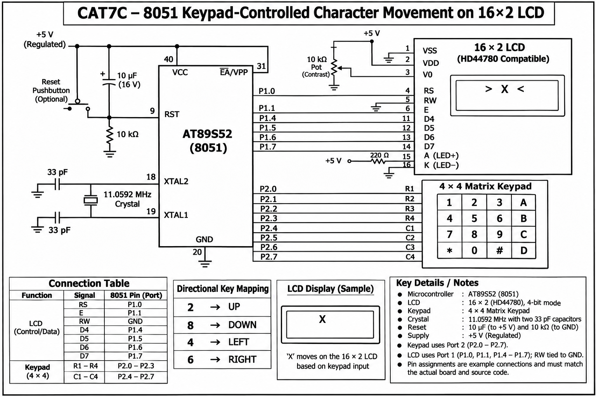

# EXPERIMENT DETAILS

**EXP:** CONTINUOUS ASSESSMENT 7 (CAT7)

**DATE:** 24/08/2026

**NAME OF EXP:** Alphanumeric 16×2 LCD Interfacing and Display Control

**HARDWARE SETUP / PLATFORM:**
- Microcontroller: AT89S52 (8051 Architecture)
- Display Module: 16×2 Character LCD (HD44780 Controller Compatible)
- Input Peripheral: 4×4 Matrix Keypad
- LCD Interface Mode: 4-Bit Parallel Data Bus
- Crystal Frequency: 11.0592 MHz
- Software: Keil µVision IDE

**TASK NO:** CAT7C – 4×4 Matrix Keypad-Driven Interactive Cursor/Character Navigation

## CIRCUIT DIAGRAM

## OBJECTIVE

- Establish a hardware interface between a 4×4 matrix keypad and the AT89S52 microcontroller.
- Connect and initialize a 16×2 HD44780-compatible LCD in 4-bit mode alongside the keypad.
- Scan and debounce matrix keystrokes in real time to drive interactive display updates.
- Navigate a target character across all four directions within the 16×2 display grid using mapped directional keys.

## CORE LOGIC

1. Execute the 4-bit initialization routine for the 16×2 LCD and render the character at its initial starting coordinate.
2. Configure the GPIO port pins connected to the 4×4 keypad rows (outputs) and columns (inputs).
3. Enter a continuous polling loop to scan the keypad matrix and debounce valid keystrokes.
4. Map specific numeric keys to four-way directional navigation commands:
   - **2** – Move Up (Row 2 → Row 1)
   - **8** – Move Down (Row 1 → Row 2)
   - **4** – Move Left (Decrement Column index)
   - **6** – Move Right (Increment Column index)
5. Decode the active keystroke and evaluate the requested movement vector with boundary checks (`0–1` for rows, `0–15` for columns).
6. Recalculate the character's updated `(row, column)` coordinates in DDRAM.
7. Erase the character from its previous cell (or clear the screen) and render it at the newly computed DDRAM address.
8. Loop indefinitely to respond dynamically to subsequent directional key inputs.

## INFERENCE

A 4×4 matrix keypad and a 4-bit 16×2 LCD were successfully integrated on the AT89S52 microcontroller to build an interactive display navigation system. Real-time row-column key scanning accurately captured directional commands (`2`, `4`, `6`, `8`) and updated the character's DDRAM coordinates seamlessly across the screen.