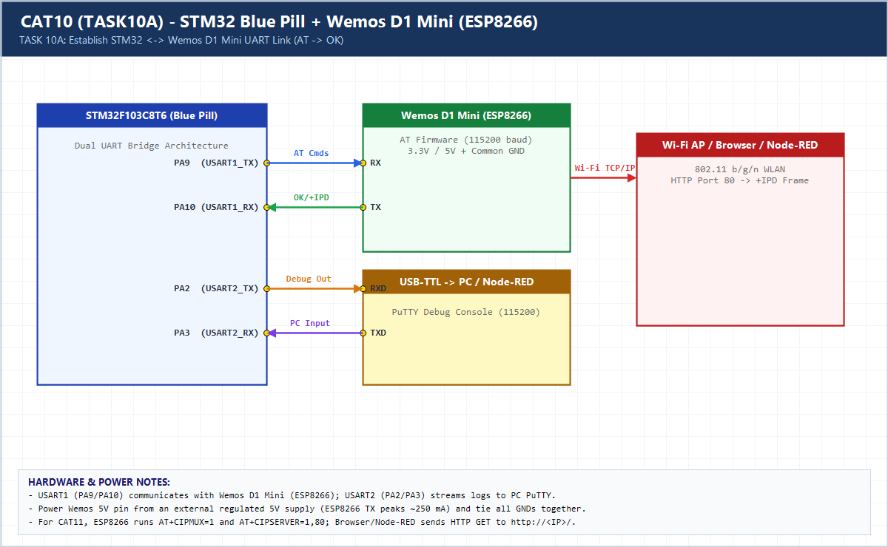

# EXPERIMENT DETAILS

**EXP:** CONTINUOUS ASSESSMENT 10 (CAT10)

**DATE:** 05/10/2026

**NAME OF EXP:** STM32–Wemos ESP8266 Wi-Fi Modem Interfacing via AT Commands

**HARDWARE SETUP / PLATFORM:** STM32CubeMX + Keil MDK-ARM + STM32F103C8T6 + Wemos D1 Mini (ESP8266)

---

## TASK 10A : Establish Bidirectional STM32 <-> Wemos UART Link

### 1. Hardware Setup & Circuit Diagram

- Modem Interface: STM32 `USART1` (`PA9` TX / `PA10` RX) cross-connected to Wemos D1 Mini (`RX` / `TX`)
- Debug Console Interface: STM32 `USART2` (`PA2` TX / `PA3` RX) wired via USB-TTL to PC PuTTY
- Power & Ground: Shared common `GND` with regulated `5V`/`3.3V` power rails

### 2. Core Logic / Pseudocode / Code Base

**Working Principle:**

Transmits the basic `AT\r\n` attention command from the STM32 over `USART1` to the ESP8266 AT firmware running on the Wemos D1 Mini, captures the incoming `OK` reply buffer, and relays the response out through `USART2` to the host PC serial monitor.

**Pseudocode:**

1. Configure and initialize both `USART1` (modem link) and `USART2` (PC diagnostic terminal).
2. Transmit the attention probe string `AT\r\n` out of `USART1`.
3. Read the returning response bytes from `USART1` and forward them to `USART2` for terminal display.

**Code Base:**

- Utilizing a dual-UART architecture isolates AT modem command-response traffic from host PC debug logging, preventing bus contention and simplifying troubleshooting.

### 3. Inference

Observing the `OK` acknowledgment on the PuTTY console validates proper TX/RX cross-wiring, synchronized `115200` bps baud rates, and active AT command firmware on the Wemos D1 Mini module.
