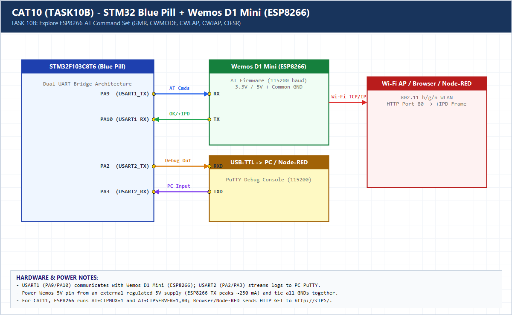

# EXPERIMENT DETAILS

**EXP:** CONTINUOUS ASSESSMENT 10 (CAT10)

**DATE:** 05/10/2026

**NAME OF EXP:** STM32–Wemos ESP8266 Wi-Fi Modem Interfacing via AT Commands

**HARDWARE SETUP / PLATFORM:** STM32CubeMX + Keil MDK-ARM + STM32F103C8T6 + Wemos D1 Mini (ESP8266)

---

## TASK 10B : ESP8266 AT Command Set Exploration & Diagnostics

### 1. Hardware Setup & Circuit Diagram

- Target Hardware: `STM32F103C8T6` Blue Pill (`USART1` interfaced to Wemos D1 Mini, `USART2` routed to PC PuTTY)

### 2. Core Logic / Pseudocode / Code Base

**Working Principle:**

Sequentially dispatches diagnostic and Wi-Fi configuration AT commands (`AT` link check, `AT+GMR` firmware revision query, `AT+CWMODE=1` Wi-Fi station mode configuration, and `AT+CWLAP` surrounding access-point scan) over `USART1` and streams the ESP8266 responses out to PuTTY via `USART2`.

**Pseudocode:**

1. Transmit `AT` to confirm active serial communication with the ESP8266 modem.
2. Issue `AT+GMR` to retrieve the installed AT command set and SDK firmware versions.
3. Configure Wi-Fi client operation via `AT+CWMODE=1` (Station mode) and execute `AT+CWLAP` to list visible nearby wireless networks (SSIDs and RSSI).

**Code Base:**

- A modular helper routine `send_at_and_log()` handles transmitting each AT command string, waiting for the modem reply buffer, and forwarding the trace output across the dual-UART bridge.

### 3. Inference

Systematic testing of these foundational commands maps out the complete ESP8266 Wi-Fi connectivity and TCP/IP client sequence (`AT`, `AT+GMR`, `AT+CWMODE`, `AT+CWLAP`, `AT+CWJAP`, `AT+CIFSR`, `AT+CIPSTART`, `AT+CIPSEND`).