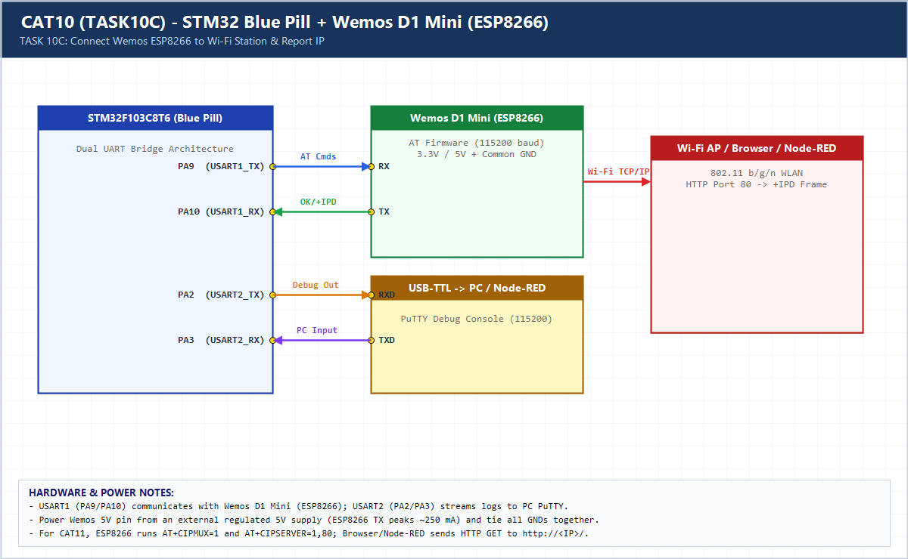

# EXPERIMENT DETAILS

**EXP:** CONTINUOUS ASSESSMENT 10 (CAT10)

**DATE:** 05/10/2026

**NAME OF EXP:** STM32–Wemos ESP8266 Wi-Fi Modem Interfacing via AT Commands

**HARDWARE SETUP / PLATFORM:** STM32CubeMX + Keil MDK-ARM + STM32F103C8T6 + Wemos D1 Mini (ESP8266)

---

## TASK 10C : Wi-Fi Station Association & DHCP IP Retrieval

### 1. Hardware Setup & Circuit Diagram

- Target Hardware: `STM32F103C8T6` Blue Pill (`USART1` interfaced to Wemos D1 Mini, `USART2` routed to PC PuTTY)

### 2. Core Logic / Pseudocode / Code Base

**Working Principle:**

Automates the end-to-end Wi-Fi access-point association sequence (`AT` -> `AT+CWMODE=1` -> `AT+CWJAP` -> `AT+CIFSR`) over `USART1`, parses the modem's connection responses, and outputs formatted status confirmation along with the assigned IPv4 address onto PuTTY via `USART2`.

**Pseudocode:**

1. Confirm serial responsiveness of the ESP8266 modem by sending `AT`.
2. Switch the wireless interface into client/station operation using `AT+CWMODE=1`.
3. Authenticate with the target Wi-Fi access point via `AT+CWJAP` and query the assigned network address using `AT+CIFSR`.

**Code Base:**

- Formats and logs `WIFI MODE : STATION`, `WIFI STATUS : CONNECTED`, and the dynamically leased DHCP IPv4 address over `USART2`.

### 3. Inference

The STM32 firmware successfully automates wireless provisioning of the Wemos D1 Mini onto a local Wi-Fi access point and extracts its leased DHCP IP address for subsequent TCP/IP communication.
