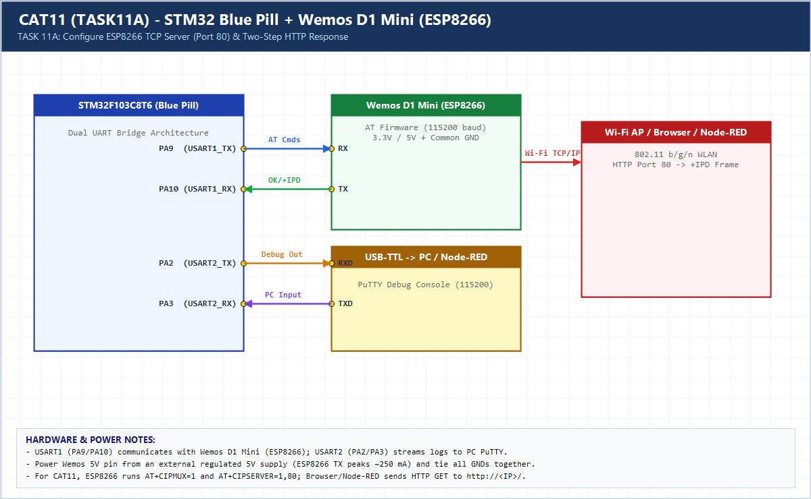

# EXPERIMENT DETAILS

**EXP:** CONTINUOUS ASSESSMENT 11 (CAT11 / 10C-10D)

**DATE:** 12/10/2026

**NAME OF EXP:** Embedded HTTP Web Server via STM32–Wemos AT Command Interface

**HARDWARE SETUP / PLATFORM:** STM32CubeMX + Keil MDK-ARM + STM32F103C8T6 + Wemos D1 Mini + Web Browser

---

## TASK 11A : ESP8266 TCP Server Initialization & Static HTML Response

### 1. Hardware Setup & Circuit Diagram

- Target Hardware: `STM32F103C8T6` Blue Pill (`USART1` interfaced to Wemos D1 Mini, `USART2` routed to PC debug console)
- HTTP Client: Standard desktop/mobile Web Browser connecting on TCP port `80`

### 2. Core Logic / Pseudocode / Code Base

**Working Principle:**

Configures the ESP8266 modem to accept multiple concurrent TCP sockets (`AT+CIPMUX=1`) and starts a listening HTTP server on port `80` (`AT+CIPSERVER=1,80`). When a client browser requests a page, the firmware intercepts the incoming `+IPD,<link_id>,<len>:GET /` payload, calculates the exact byte size for the `Content-Length` header, executes a two-phase `AT+CIPSEND` transfer to deliver the HTML document, and terminates the socket with `AT+CIPCLOSE`.

**Pseudocode:**

1. Enable multiple socket connections (`AT+CIPMUX=1`) and launch the TCP listener (`AT+CIPSERVER=1,80`).
2. Monitor `USART1` for incoming client request frames prefixed with `+IPD,<link_id>,...`.
3. Assemble a standards-compliant `HTTP/1.1 200 OK` header with an accurate `Content-Length` field paired with the static HTML body.
4. Send `AT+CIPSEND=<link_id>,<len>`, await the `>` ready prompt from the modem, stream the complete HTTP response, and close the link (`AT+CIPCLOSE=<link_id>`).

**Code Base:**

- Following the two-stage `AT+CIPSEND` handshake ensures exact byte-count framing so modern web browsers render the HTML payload reliably without hanging.

### 3. Inference

By orchestrating TCP socket commands over UART, the STM32 operates as a compact embedded HTTP server capable of delivering properly formatted HTML web pages to any client browser on the local network.
