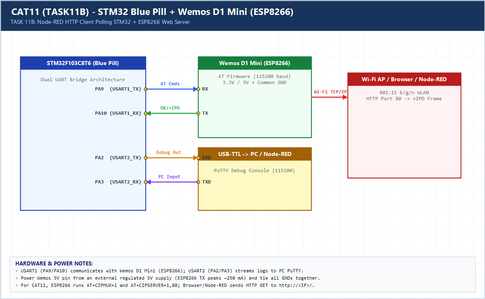

# EXPERIMENT DETAILS

**EXP:** CONTINUOUS ASSESSMENT 11 (CAT11 / 10E)

**DATE:** 12/10/2026

**NAME OF EXP:** Embedded HTTP Web Server via STM32–Wemos AT Command Interface

**HARDWARE SETUP / PLATFORM:** STM32CubeMX + Keil MDK-ARM + STM32F103C8T6 + Wemos D1 Mini + Node-RED

---

## TASK 11B : Node-RED Integration as an HTTP Client for the STM32/ESP8266 Server

### 1. Hardware Setup & Circuit Diagram

- Embedded HTTP Server: `STM32F103C8T6` Blue Pill paired with Wemos D1 Mini Wi-Fi modem
- Client Pipeline (`node_red_flow.json`): Node-RED flow wired as `Inject -> HTTP Request (http://<ESP8266_IP>/) -> Debug`

### 2. Core Logic / Pseudocode / Code Base

**Working Principle:**

Exposes live JSON system-uptime telemetry on TCP port `80`, allowing both standard web browsers and an automated Node-RED `http request` flow (`Inject -> HTTP Request -> Debug`) to query and parse data from the STM32 edge node.

**Pseudocode:**

1. Configure and launch the ESP8266 TCP server listening on port `80`.
2. Upon intercepting an incoming `+IPD` HTTP GET request, format a JSON string embedding the current uptime from `HAL_GetTick()`.
3. Transmit a complete HTTP response specifying `Content-Type: application/json` alongside the calculated `Content-Length` header.
4. Load `node_red_flow.json` into the Node-RED workspace to periodically poll `http://<ESP8266_IP>/` and inspect the parsed output.

**Code Base:**

- Bundles a preconfigured `node_red_flow.json` export implementing the `Inject -> HTTP Request -> Debug` polling pipeline.

### 3. Inference

Node-RED connects effortlessly as an automated HTTP client alongside traditional web browsers, laying the groundwork for scheduled telemetry polling, data logging, and visual IoT dashboards.
