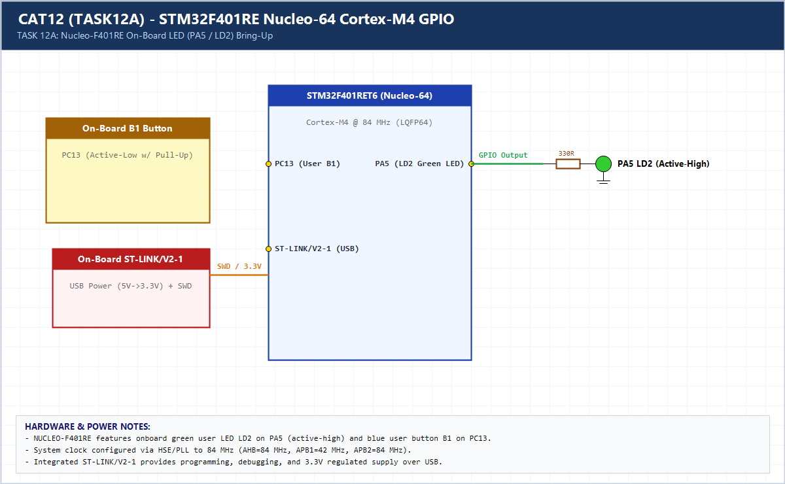

# EXPERIMENT DETAILS

**EXP:** CONTINUOUS ASSESSMENT 12 (CAT12 / 11)

**DATE:** 14/10/2026

**NAME OF EXP:** STM32F401RE Cortex-M4: Digital GPIO & User Input Interfacing

**HARDWARE SETUP / PLATFORM:** STM32CubeMX + Keil MDK-ARM + STM32 Nucleo-F401RE (ARM Cortex-M4 @ 84 MHz)

---

## TASK 12A (Task 1) : On-Board User LED Hardware Bring-Up

### 1. Hardware Setup & Circuit Diagram

- Target Board: STM32 `NUCLEO-F401RE` (`STM32F401RET6`, LQFP64 package)
- System Clock: 84 MHz `SYSCLK` derived via PLL
- On-Board LED: `PA5` (Green User LED `LD2`, active-high logic)

### 2. Core Logic / Pseudocode / Code Base

**Working Principle:**

Initializes pin `PA5` as a standard push-pull digital output and periodically inverts the on-board green LED (`LD2`) on the Nucleo-F401RE every 500 ms (`1 Hz` blink rate) to confirm proper PLL clock tree setup and GPIO peripheral operation.

**Pseudocode:**

1. Initialize the STM32 HAL layer, configure the 84 MHz system clock, and set `PA5` as a push-pull output.
2. Inside the infinite `while(1)` super-loop, execute `HAL_GPIO_TogglePin(GPIOA, GPIO_PIN_5)` followed by `HAL_Delay(500)`.

**Code Base:**

- Aligned with the STM32CubeMX `LED_TOGGLE_F401RE` hardware configuration for the `STM32F401RET6` MCU.

### 3. Inference

User LED `LD2` connected to `PA5` toggles cleanly at 1 Hz, confirming successful ST-LINK firmware programming, accurate 84 MHz PLL clock initialization, and functional ARM Cortex-M4 GPIO output control.
