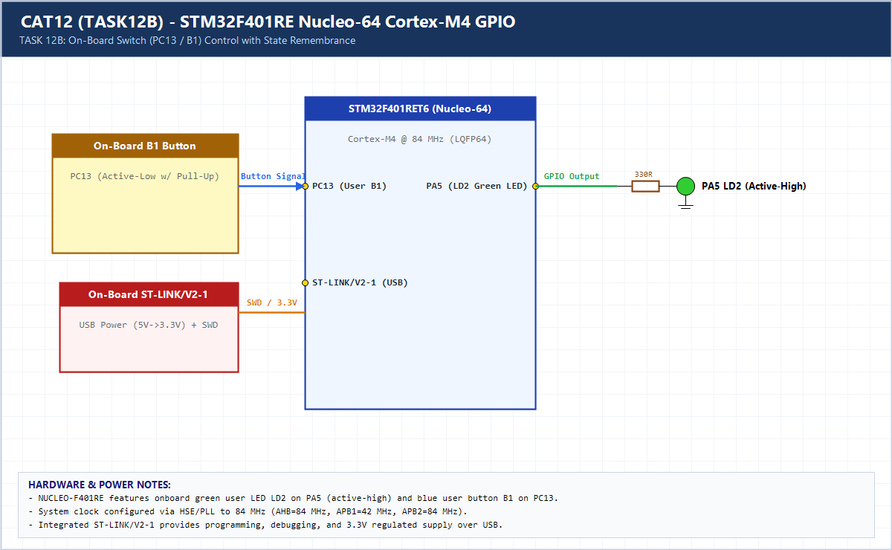

# EXPERIMENT DETAILS

**EXP:** CONTINUOUS ASSESSMENT 12 (CAT12 / 11)

**DATE:** 14/10/2026

**NAME OF EXP:** STM32F401RE Cortex-M4: Digital GPIO & User Input Interfacing

**HARDWARE SETUP / PLATFORM:** STM32CubeMX + Keil MDK-ARM + STM32 Nucleo-F401RE

---

## TASK 12B (Task 2) : On-Board Push-Button Control with Latched State Memory

### 1. Hardware Setup & Circuit Diagram

- Target Board: STM32 `NUCLEO-F401RE`
- On-Board LED: `PA5` (Green User LED `LD2`)
- On-Board User Button `B1`: `PC13` (Active-Low with external pull-up)

### 2. Core Logic / Pseudocode / Code Base

**Working Principle:**

Samples the Nucleo user push-button `B1` (`PC13`) using a non-blocking 50 ms debounce filter and toggles a persistent boolean flag (`led_state`) upon every validated press, maintaining the updated LED output even after the switch is released.

**Pseudocode:**

1. Poll `PC13` and detect a high-to-low falling edge transition (`SET -> RESET`).
2. Enforce a 50 ms stability window using `HAL_GetTick()` to suppress mechanical contact bounce.
3. Toggle `led_state` and drive `PA5` accordingly, holding the output state steady once `PC13` returns to `SET`.

**Code Base:**

- Implements a latched toggle state machine driven by `led_state` memory and `prev_btn` edge detection.

### 3. Inference

User LED `LD2` reliably latches between ON and OFF states across repeated button presses and releases without any false triggers from switch bounce.
