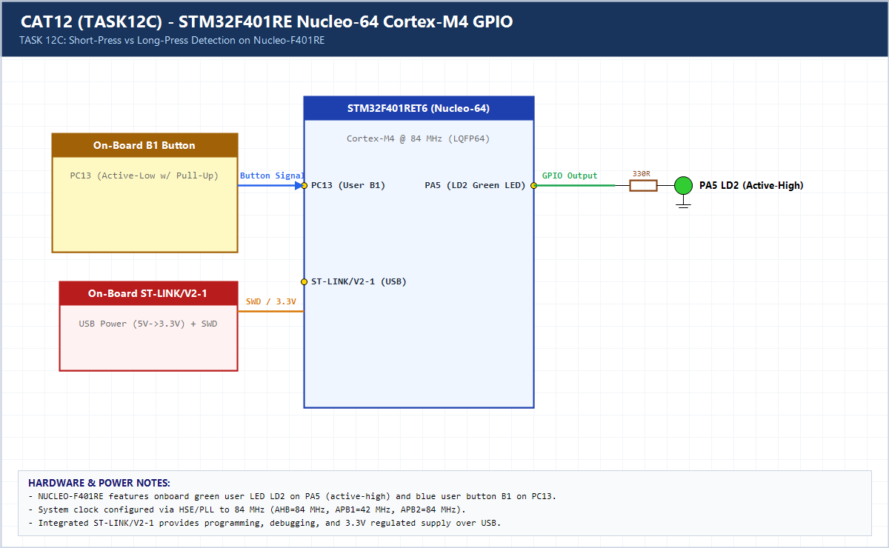

# EXPERIMENT DETAILS

**EXP:** CONTINUOUS ASSESSMENT 12 (CAT12 / 11)

**DATE:** 14/10/2026

**NAME OF EXP:** STM32F401RE Cortex-M4: Digital GPIO & User Input Interfacing

**HARDWARE SETUP / PLATFORM:** STM32CubeMX + Keil MDK-ARM + STM32 Nucleo-F401RE

---

## TASK 12C (Task 3) : Short-Press vs. Long-Press Duration Classification

### 1. Hardware Setup & Circuit Diagram

- Target Board: STM32 `NUCLEO-F401RE`
- Input Peripheral: On-Board User Button `B1` (`PC13`)
- Output Peripheral: On-Board User LED `LD2` (`PA5`)

### 2. Core Logic / Pseudocode / Code Base

**Working Principle:**

Tracks the actuation duration of user button `PC13` non-blockingly via `HAL_GetTick()`. A brief actuation (`less than 1000 ms`) either toggles `PA5` once or halts active blinking, whereas a sustained hold (`1000 ms or longer`) initiates continuous LED blinking at a 200 ms interval.

**Pseudocode:**

1. Capture the initial SysTick timestamp when a validated press edge occurs on `PC13`.
2. Upon button release, compute elapsed hold time and classify `< 1000 ms` as a short press and `>= 1000 ms` as a long press.
3. Dispatch the corresponding LED toggle or 200 ms non-blocking blink state without stalling the main loop.

**Code Base:**

- Non-blocking `HAL_GetTick()` pulse-width / hold-duration state classifier implemented on ARM Cortex-M4.

### 3. Inference

Multi-function single-button input classification operates reliably on the Nucleo-F401RE while keeping the CPU completely unblocked for concurrent tasks.