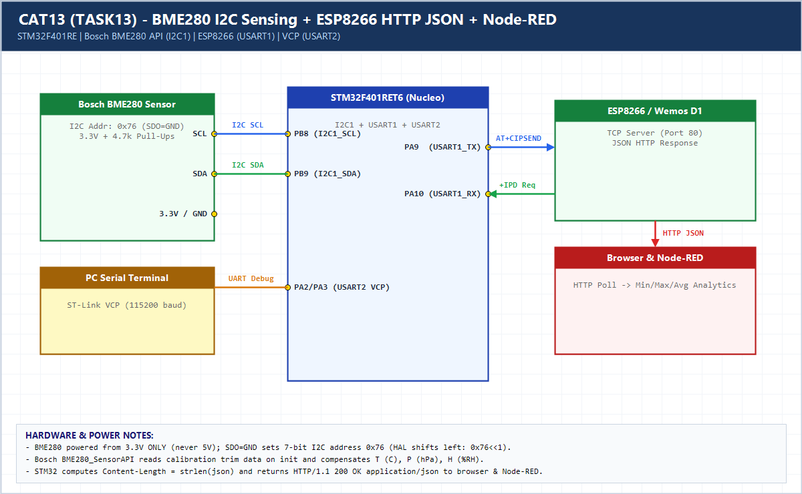

# EXPERIMENT DETAILS

**EXP:** CONTINUOUS ASSESSMENT 13 (CAT13 / 12)

**DATE:** 23/10/2026

**NAME OF EXP:** Environmental Sensor Interfacing (BME280) – STM32 (UART Debug) – ESP8266 (Wi-Fi HTTP Server) – Node-RED Analytics

**HARDWARE SETUP / PLATFORM:** STM32CubeMX + Keil MDK-ARM + STM32 Nucleo-F401RE + BME280 + ESP8266 + Node-RED

---

## TASK 13 : Bosch BME280 I2C Acquisition & HTTP Telemetry Streaming

### 1. Hardware Setup & Circuit Diagram

- Target MCU Board: STM32 `NUCLEO-F401RE`
- Environmental Sensor: Bosch BME280 connected to `I2C1` (`PB8` = `SCL`, `PB9` = `SDA`, 7-bit address `0x76`, `3.3V` power)
- Wi-Fi Modem Interface: ESP8266 wired to `USART1` (`PA9` TX / `PA10` RX)
- Diagnostic Console: Host PC serial monitor over `USART2` (`PA2` TX / `PA3` RX)

### 2. Core Logic / Pseudocode / Code Base

**Working Principle:**

Integrates the official Bosch `BME280_SensorAPI` (`bme280.c`, `bme280.h`, `bme280_defs.h`) through custom STM32 HAL `I2C1` bus callback functions, streams calibrated temperature, barometric pressure, and relative humidity readings over `USART2`, packages the telemetry into a dynamic JSON payload with an exact `Content-Length` header, and serves it through the ESP8266 HTTP server to both web browsers and Node-RED for live Min/Max/Average statistical tracking.

**Pseudocode:**

1. Register platform-specific `user_i2c_read`, `user_i2c_write`, and `user_delay_us` callbacks inside `struct bme280_dev`.
2. Initialize the sensor via `bme280_init()` and set 1x oversampling across temperature, pressure, and humidity in normal power mode.
3. Sample compensated environmental readings every 1 second using `bme280_get_sensor_data()`.
4. Serialize the readings into a JSON string, compute exact byte length via `strlen(json)`, and transmit the HTTP response over the ESP8266 socket using `AT+CIPSEND`.

**Code Base:**

- Incorporates official Bosch `BME280_SensorAPI` driver files alongside `node_red_flow.json` to calculate real-time Minimum, Maximum, and Average environmental metrics.

### 3. Inference

Applying Bosch's factory calibration compensation yields reliable, high-precision environmental measurements, while dynamically calculating HTTP `Content-Length` framing ensures clean JSON ingestion for real-time Node-RED analytics.