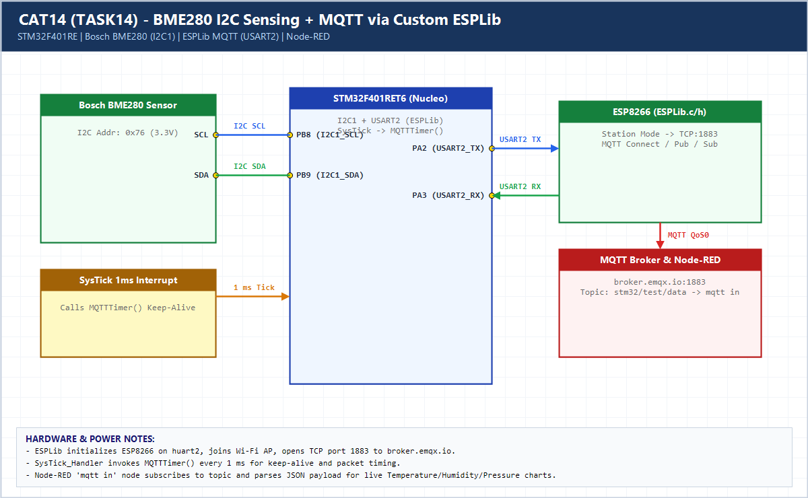

# EXPERIMENT DETAILS

**EXP:** CONTINUOUS ASSESSMENT 14 (CAT14 / 13)

**DATE:** 27/10/2026

**NAME OF EXP:** Environmental Sensor Interfacing (BME280) – MQTT Telemetry – Node-RED Analytics

**HARDWARE SETUP / PLATFORM:** STM32CubeMX + Keil MDK-ARM + STM32 Nucleo-F401RE + BME280 + ESP8266 + EMQX MQTT Broker + Node-RED

---

## TASK 14 : BME280 I2C Acquisition & MQTT Telemetry Publishing via Custom ESP8266 API

### 1. Hardware Setup & Circuit Diagram

- Target MCU Board: STM32 `NUCLEO-F401RE`
- Environmental Sensor: Bosch BME280 interfaced on `I2C1` (`PB8` SCL / `PB9` SDA, 7-bit address `0x76`)
- Wi-Fi Modem Interface: ESP8266 wired to `USART2` (`PA2` TX / `PA3` RX)
- Cloud/Local Broker & Dashboard: EMQX MQTT Broker (`broker.emqx.io:1883`) feeding Node-RED `mqtt in` node

### 2. Core Logic / Pseudocode / Code Base

**Working Principle:**

Acquires calibrated temperature, pressure, and humidity readings from the BME280 over `I2C1`, serializes them into a JSON string, and publishes the telemetry at `QoS0` to the `stm32/test/data` topic on `broker.emqx.io:1883` via the custom `ESPLib` driver (`ESP8266_Init`, `ESP8266_wifiConnect`, `ESP8266_portConnect`, `MQTT_connectBroker`, `MQTT_publishTopic`). Inside `SysTick_Handler()`, `MQTTTimer()` executes every 1 ms to drive non-blocking protocol timing.

**Pseudocode:**

1. Initialize the BME280 peripheral on `I2C1` and configure the Wi-Fi modem via `ESP8266_Init(StationMode, huart2)`.
2. Associate with the local Wi-Fi access point (`ESP8266_wifiConnect`) and establish a TCP socket to `broker.emqx.io:1883` (`ESP8266_portConnect`).
3. Transmit the MQTT `CONNECT` control packet using `MQTT_connectBroker()`.
4. At 1-second intervals, sample the BME280 sensor, assemble the JSON telemetry string, and publish it via `MQTT_publishTopic("stm32/test/data", json, QoS0)`.
5. Subscribe to `stm32/test/data` in Node-RED using an `mqtt in` node to parse and display real-time telemetry.

**Code Base:**

- Custom `ESPLib.h` and `ESPLib.c` implement AT command transport alongside binary MQTT 3.1.1 `CONNECT`, `PUBLISH`, and `SUBSCRIBE` packet framing.
- `stm32f4xx_it.c` invokes `MQTTTimer()` every millisecond within `SysTick_Handler()` to manage keep-alive and timeout counters.

### 3. Inference

Transitioning from request/response HTTP polling to a lightweight MQTT publish/subscribe architecture decouples the STM32 edge node from downstream Node-RED consumers while substantially reducing packet overhead and bandwidth consumption.
