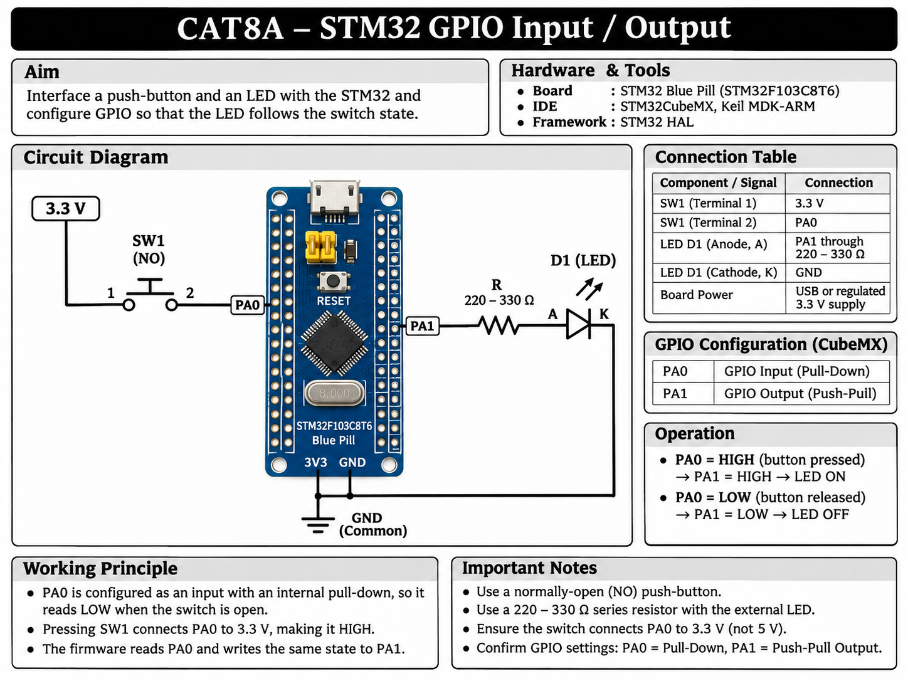

# CAT8A – STM32 Digital GPIO Input/Output Interfacing

## Experiment Details

- **Course:** 25CS2741 – Fundamentals of Internet of Things + Lab
- **Assessment:** Continuous Lab Evaluation 8A
- **Date:** 18/09/2026
- **Experiment:** STM32 GPIO Hardware Bring-Up and Tactile Switch-Driven LED Control
- **Board:** STM32 Blue Pill (STM32F103C8T6 ARM Cortex-M3)
- **IDE:** STM32CubeMX and Keil MDK-ARM
- **Framework:** STM32 Hardware Abstraction Layer (HAL)

## 1. Aim

To configure General-Purpose Input/Output (GPIO) pins on the STM32F103C8T6 microcontroller to read a tactile push-button input and mirror its logic state onto an external LED output.

## 2. Hardware Requirements

- STM32F103C8T6 Blue Pill development board
- Momentary normally-open (NO) tactile push-button
- External 5mm LED
- Current-limiting resistor (220–330 Ω)
- Solderless breadboard and male-to-male jumper wires
- USB cable / 3.3 V regulated power source

## 3. Hardware Connections

| Component | STM32 Connection |
|---|---|
| Push-button terminal 1 | 3.3 V rail |
| Push-button terminal 2 | PA0 |
| LED anode (+) | PA1 via 220–330 Ω resistor |
| LED cathode (−) | GND rail |
| Board power | USB / regulated 3.3 V |

### GPIO Configuration

| Pin | Mode | Configuration |
|---|---|---|
| PA0 | GPIO_Input | Internal Pull-Down enabled |
| PA1 | GPIO_Output | Push-Pull, Low speed |

## 4. Circuit Diagram

## 5. Working Principle

Two GPIO pins on Port A are configured via STM32CubeMX: `PA0` acts as a digital sensor input for the push-button, while `PA1` serves as a push-pull digital output driving the external LED.

- When the push-button is unpressed (open), the internal pull-down resistor anchors `PA0` firmly to `GND` (logic `0` / `LOW`).
- When the push-button is actuated (closed), `PA0` connects directly to the `3.3 V` supply rail, pulling the pin to logic `1` (`HIGH`).
- Inside the infinite execution loop, the firmware samples `PA0` using `HAL_GPIO_ReadPin()`.
- The sampled logic state is immediately mirrored onto `PA1` via `HAL_GPIO_WritePin()`.

As a result, the external LED illuminates exclusively while the button is held down and extinguishes the instant it is released.

## 6. Core Logic / Pseudocode

1. Initialize the STM32 HAL layer and configure the system clock tree.
2. Enable peripheral clocks for GPIO Port A and initialize pin configurations.
3. Set `PA0` as a digital input with its internal pull-down resistor active.
4. Set `PA1` as a standard push-pull digital output.
5. Drive `PA1` to an initial `LOW` (`GPIO_PIN_RESET`) state so the LED starts OFF.
6. Enter the main `while (1)` loop and poll the logic level on `PA0`.
7. If `PA0` reads `GPIO_PIN_SET` (`HIGH`), assert `PA1` to `GPIO_PIN_SET` (`HIGH`).
8. Otherwise, clear `PA1` to `GPIO_PIN_RESET` (`LOW`).
9. Loop continuously to maintain real-time responsiveness.

## 7. HAL Functions Used

- `HAL_Init()` – Resets peripherals and initializes the Flash interface and SysTick timer.
- `HAL_GPIO_ReadPin()` – Samples the current digital logic level (`SET` or `RESET`) of an input pin.
- `HAL_GPIO_WritePin()` – Drives a configured output pin to a specified logic state.
- `HAL_RCC_OscConfig()` – Configures the internal/external oscillators and PLL multipliers.
- `HAL_RCC_ClockConfig()` – Sets up the AHB, APB1, and APB2 bus clock dividers.

## 8. Expected Observation

| Button State | PA0 Input | PA1 Output | LED |
|---|---|---|---|
| Released | LOW | LOW | OFF |
| Pressed | HIGH | HIGH | ON |

## 9. Inference

Digital GPIO input sensing and output actuation were successfully demonstrated using the STM32 HAL driver suite on the STM32F103C8T6 Blue Pill. Enabling the internal pull-down resistor on `PA0` prevented floating-pin noise when the switch was open, ensuring deterministic, glitch-free LED control during continuous polling.

## 10. Project Files

- `Core/Src/main.c` – Primary application firmware and main execution loop.
- `Core/Inc/main.h` – Global pin definitions and header declarations.
- `Blinky.ioc` – STM32CubeMX hardware pinout and clock configuration file.
- `MDK-ARM/Blinky.uvprojx` – Keil MDK-ARM uVision project file.
- `MDK-ARM/startup_stm32f103xb.s` – Cortex-M3 startup and vector table assembly file.
- `circuit.png` – Schematic and breadboard wiring diagram.

## 11. Safety Notes

- Connect the push-button strictly to `3.3 V`—never route `5 V` into `PA0` as it is not 5 V-tolerant when configured with pull-down/analog functions.
- Ensure the internal pull-down resistor is enabled on `PA0` to avoid undefined floating states.
- Always place a 220–330 Ω resistor in series with the LED to protect the GPIO driver from overcurrent damage.
- Double-check LED anode/cathode orientation prior to applying USB power.
- Verify that the STM32 board and all breadboard components share a common ground (`GND`).
