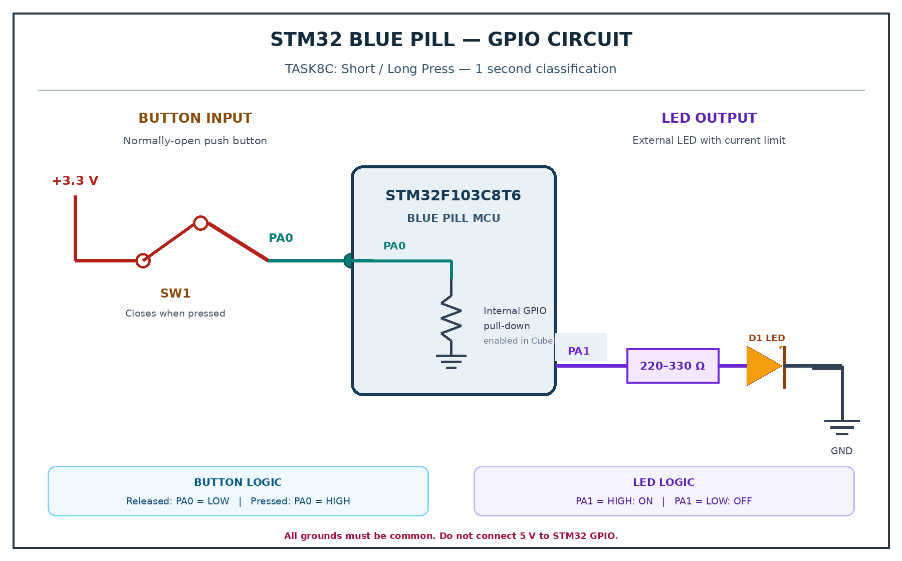

# CAT 8 — Task 8C: Short Press vs. Long Press Event Classification

## Experiment details

- **Course:** 25CS2741 — Fundamentals of Internet of Things + Lab
- **Assessment:** Continuous Lab Evaluation 8C
- **Date on assignment:** 18/09/2026
- **Experiment:** STM32 Short Press vs. Long Press Duration Classification
- **Board:** STM32 Blue Pill (STM32F103C8T6 ARM Cortex-M3)
- **IDE / framework:** STM32CubeMX, Keil MDK-ARM, STM32 HAL

## Aim

Measure the hold duration of a tactile push-button actuation and execute distinct LED control states based on press length:

| User action | Required system response |
|---|---|
| Short press (less than 1 second) | Toggle LED state once |
| Long press (1 second or longer) | Activate continuous LED blinking mode |
| Next short press | Halt continuous blinking |
| Long press again | Re-enter continuous blinking mode |

## Hardware setup

| Component / signal | Connection | Configuration |
|---|---|---|
| Push-button SW1 | Connects 3.3 V to PA0 when closed | PA0 digital input with internal pull-down |
| LED D1 anode | PA1 via 220–330 Ω resistor | PA1 push-pull digital output |
| LED D1 cathode | GND | Common ground reference |

The tactile switch is normally open (NO), keeping `PA0` at `LOW` when idle and pulling it `HIGH` upon actuation. The external LED is driven by `PA1` through a series current-limiting resistor.

## Circuit diagram

## Working principle

The application implements a non-blocking, timestamp-driven state machine so that CPU execution never stalls inside a blocking delay while evaluating press duration.

1. `Switch_Update()` filters mechanical bounce on `PA0` by enforcing a `30 ms` signal stability threshold.
2. Upon detecting a validated rising edge (`PA0` transitions `HIGH`), the firmware captures `pressStart = HAL_GetTick()`.
3. While the push-button remains depressed, the main `while (1)` loop continues executing uninterrupted.
4. Upon detecting a validated falling edge (`PA0` transitions `LOW`), the elapsed hold time is computed via `duration = HAL_GetTick() - pressStart`.
5. If `duration` equals or exceeds **1000 ms**, the firmware activates continuous blinking mode.
6. If `duration` is under 1000 ms, the event is classified as a short press:
   - If continuous blinking is currently running, blinking is disabled.
   - Otherwise, the LED output state is inverted once.
7. Whenever blinking mode is active, `PA1` is inverted every **250 ms** using non-blocking `HAL_GetTick()` comparisons.

Pressing and holding the button again after blinking has been halted reactivates blinking mode as specified. Unsigned subtraction on `HAL_GetTick()` values guarantees accurate elapsed-time calculation even across 32-bit SysTick counter rollovers.

## Core logic / pseudocode

1. Initialize the HAL layer, system clock tree, and GPIO Port A peripherals.
2. Configure `PA0` as an input with internal pull-down enabled, and `PA1` as a push-pull output.
3. Define timing constants: debounce window = `30 ms`, long-press threshold = `1000 ms`, and blink toggle period = `250 ms`.
4. Invoke the non-blocking `Switch_Update()` routine continuously inside the main loop.
5. When a debounced press edge occurs, save the current SysTick timestamp in `pressStart`.
6. When a debounced release edge occurs, compute `duration` from the elapsed ticks.
7. If `duration` is at least `1000 ms`, set the blinking mode flag active.
8. Otherwise, check the blinking flag: if active, clear it to stop blinking; if inactive, toggle `PA1` once.
9. While the blinking flag is active and `250 ms` has elapsed since the previous toggle, invert `PA1`.
10. Loop continuously.

## HAL functions used

- `HAL_GPIO_ReadPin()` — samples the instantaneous logic level of `PA0`.
- `HAL_GetTick()` — captures press timestamps, computes hold duration, and schedules non-blocking blink intervals.
- `HAL_GPIO_TogglePin()` — inverts the logic level of `PA1` for single toggles and periodic blinking.
- `HAL_GPIO_WritePin()` — sets the initial or stopped logic level of `PA1`.
- `HAL_Init()` — initializes the STM32 HAL framework and configures the 1 ms SysTick time base.

## Important constraint

**Do not use `HAL_Delay()` or any blocking wait loop to measure press duration.** The main loop must remain free to run concurrently while the button is held down. Both duration measurement and periodic LED blinking rely exclusively on non-blocking `HAL_GetTick()` timestamp comparisons.

## Expected observation / result

- Actuating the button for less than 1 second toggles the LED once.
- Holding the button for 1 second or longer initiates continuous LED blinking at a 250 ms toggle rate.
- Performing a short press while blinking is active stops the blinking.
- Performing another long press re-enables continuous blinking mode.

Verify and log the observed behavior on your target hardware prior to final submission.

## Inference

This experiment demonstrates non-blocking, duration-based event classification using the STM32 HAL SysTick timer. Measuring elapsed ticks between debounced press and release edges enables reliable differentiation between short and long actuations, while timestamp-scheduled blinking keeps the main execution loop completely responsive without blocking delays.

## Files

- `Core/Src/main.c` — primary firmware state machine, debounce routine, and SysTick timing logic.
- `Core/Inc/main.h` — pin mappings and application header declarations.
- `Blinky.ioc` — STM32CubeMX peripheral and clock configuration file.
- `MDK-ARM/Blinky.uvprojx` — Keil MDK-ARM project file.
- `MDK-ARM/startup_stm32f103xb.s` — Cortex-M3 startup assembly file.
- `circuit.png` — hardware schematic and breadboard wiring diagram.

## Safety and wiring checks

- Wire the tactile push-button strictly between `PA0` and `3.3 V`, with `PA0`'s internal pull-down enabled.
- Never apply `5 V` directly to `PA0`.
- Place a 220–330 Ω current-limiting resistor in series with the external LED.
- Confirm proper LED anode and cathode polarity before applying power to the Blue Pill board.
