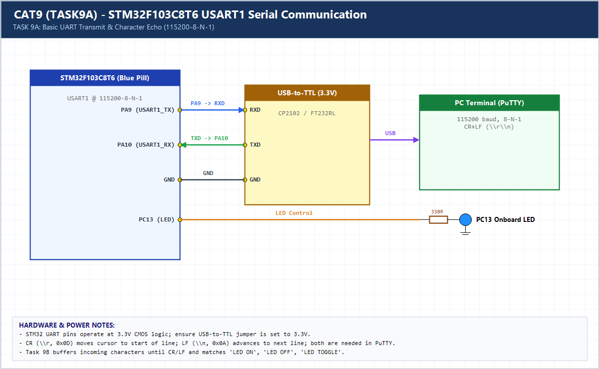

# EXPERIMENT DETAILS

**EXP:** CONTINUOUS ASSESSMENT 9 (CAT9)

**DATE:** 28/09/2026

**NAME OF EXP:** STM32 Serial UART Command-Controlled LED System

**HARDWARE SETUP / PLATFORM:** STM32CubeMX + Keil MDK-ARM + STM32F103C8T6 + USB-TTL + PuTTY

---

## TASK 9A : Basic UART Serial Initialization & Character Echo

### 1. Hardware Setup & Circuit Diagram

- Target MCU: Blue Pill (`STM32F103C8T6` ARM Cortex-M3)
- Serial Interface (`USART1`): `PA9` (TX) wired to USB-TTL `RXD`, `PA10` (RX) wired to USB-TTL `TXD`, configured at `115200-8-N-1` (plus common `GND`)

### 2. Core Logic / Pseudocode / Code Base

**Working Principle:**

Configures the `USART1` peripheral for asynchronous serial communication at `115200` bps (8 data bits, no parity, 1 stop bit). On startup, the firmware transmits `HELLO\r\nWORLD\r\n` to illustrate how Carriage Return (`\r`) and Line Feed (`\n`) control terminal cursor alignment, and subsequently loops back every incoming character received from PuTTY.

**Pseudocode:**

1. Initialize HAL, system clock, and the `USART1` peripheral at `115200-8-N-1`.
2. Send the initial two-line CR+LF verification string (`HELLO\r\nWORLD\r\n`) over `USART1`.
3. Continuously poll for incoming bytes using `HAL_UART_Receive()` and immediately echo each captured byte back to the host terminal via `HAL_UART_Transmit()`.

**Code Base:**

- Carriage Return (`\r`, ASCII `0x0D`) resets the terminal cursor back to the leftmost column (`column 0`), whereas Line Feed (`\n`, ASCII `0x0A`) advances the cursor vertically to the next row; combining both ensures properly aligned multi-line output in PuTTY.

### 3. Inference

Successfully established full-duplex asynchronous serial communication between the STM32F103C8T6 and the host PC terminal at 115200 bps, while demonstrating the distinct roles of CR (`\r`) and LF (`\n`) escape characters in formatting terminal text streams.
