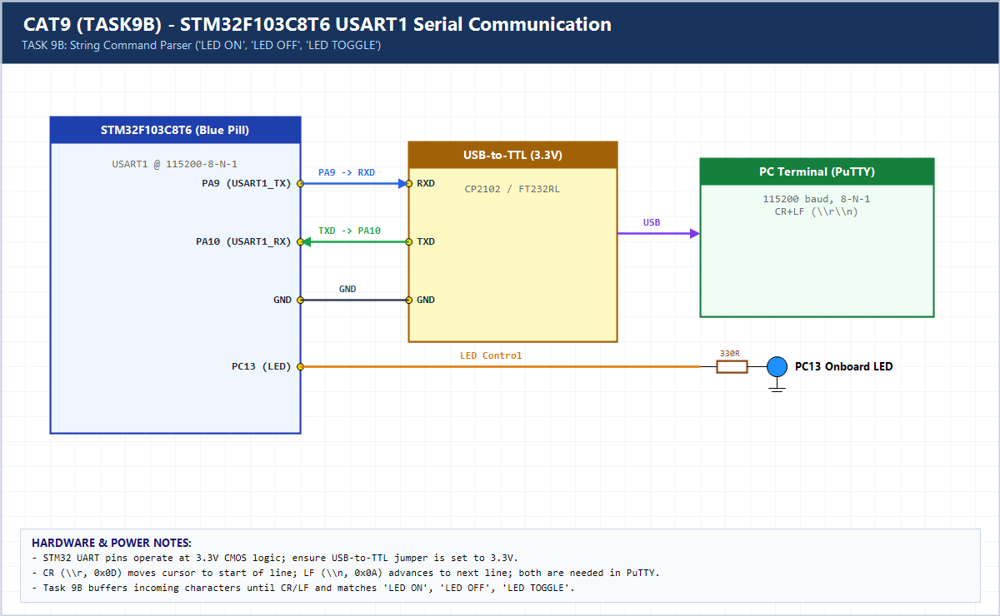

# EXPERIMENT DETAILS

**EXP:** CONTINUOUS ASSESSMENT 9 (CAT9)

**DATE:** 28/09/2026

**NAME OF EXP:** STM32 Serial UART Command-Controlled LED System

**HARDWARE SETUP / PLATFORM:** STM32CubeMX + Keil MDK-ARM + STM32F103C8T6 + USB-TTL + PuTTY

---

## TASK 9B : String-Based Command Parser (LED ON / OFF / TOGGLE)

### 1. Hardware Setup & Circuit Diagram

- Target MCU: Blue Pill (`STM32F103C8T6` ARM Cortex-M3)
- Serial Interface: `USART1` (`PA9` TX / `PA10` RX) connected to PC PuTTY terminal
- Output Actuator: On-board user LED wired to `PC13` (active-low)

### 2. Core Logic / Pseudocode / Code Base

**Working Principle:**

Collects incoming serial characters into a receive character array until a line-ending delimiter (`\r` or `\n`) is detected. Once terminated, the parser compares the received string against `LED ON`, `LED OFF`, and `LED TOGGLE` using `strcmp()`, updates the output state of `PC13` accordingly, and sends an acknowledgment response back to the serial console.

**Pseudocode:**

1. Read incoming bytes sequentially into a character buffer until a Carriage Return (`\r`) or Line Feed (`\n`) arrives.
2. Append a null terminator (`'\0'`) to form a valid C string and match it against `LED ON`, `LED OFF`, and `LED TOGGLE`.
3. Trigger the matching GPIO write/toggle operation on `PC13` and transmit a status confirmation string back over `USART1`.

**Code Base:**

- Illustrates delimiter-based packet/command framing over asynchronous UART by combining `HAL_UART_Receive()` byte polling with standard C string matching (`strcmp()`).

### 3. Inference

Implementing delimiter-framed string parsing over UART turns a basic byte-stream interface into a structured command-line interpreter (CLI) capable of executing deterministic hardware control commands.
